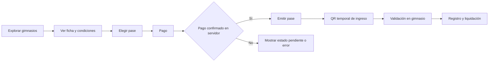

# BROFIT — ya | Documento maestro del producto

> **Eslogan:** Entrena donde quieras.  
> **Versión:** 1.0 — especificación inicial para construir el MVP  
> **Estado:** Concepto de producto y diseño aprobado para prototipado; operación comercial y marca pendientes de validación.  
> **Diseño de referencia:** [DESIGN.md](./DESIGN.md)

---

## 1. Visión

**BROFIT — ya** es una plataforma web de descubrimiento y acceso a gimnasios afiliados. Una persona puede encontrar gimnasios cercanos, comparar instalaciones y equipamiento, comprar pases de una visita o contratar una membresía que habilite visitas a distintos gimnasios de la red, según las condiciones de su plan.

**Promesa de marca:** «Entrena donde quieras.»  
**Propuesta de valor:** múltiples espacios para entrenar, una experiencia unificada de búsqueda, compra y acceso.  
**Posicionamiento:** marketplace fitness y plataforma multigimnasio; **no** es una aplicación de rutinas, dieta ni coaching en su MVP.

### Objetivos de producto

1. Facilitar el descubrimiento de gimnasios por ubicación, precio, equipamiento y servicios.
2. Permitir comprar un pase individual con términos transparentes.
3. Permitir usar visitas incluidas en un plan multigimnasio, sin prometer visitas ilimitadas por defecto.
4. Habilitar una validación de ingreso segura y rápida mediante QR.
5. Dar a los gimnasios un panel para gestionar su presencia y registrar ingresos.
6. Dar al equipo operador herramientas para configurar catálogos, planes, pagos y liquidaciones.

### Público inicial

- **Usuarios:** personas que entrenan ocasionalmente, se desplazan por la ciudad o desean probar diferentes gimnasios.
- **Aliados:** gimnasios independientes que buscan nuevos visitantes y capacidad de monetizar horarios.
- **Operación:** administradores de BROFIT que verifican gimnasios, gestionan incidencias y supervisan transacciones.

> El piloto debe centrarse en **una sola ciudad o zona configurable**, con pocos gimnasios asociados de verdad. No declarar alianzas, precios, valoraciones ni números de usuarios antes de verificarlos.

---

## 2. Modelo de negocio híbrido

| Producto | Qué adquiere la persona | Regla central |
|---|---|---|
| Pase individual | Derecho de ingreso a **un gimnasio** para una visita y dentro de una vigencia definida | Precio y condiciones definidos por oferta |
| Membresía multigimnasio | **N visitas** utilizables en gimnasios elegibles de la red durante un periodo | Cupo, vigencia, restricciones y gimnasios elegibles explícitos |

**Políticas configurables (no codificar tarifas fijas):**

- Precio de venta, moneda PEN, duración de la oferta, tiempo de validez y visitas incluidas.
- Ventanas de uso y restricciones por gimnasio, aforo y tipo de equipamiento, si correspondiera.
- Cupo máximo de visitas por gimnasio o por periodo para cada membresía.
- Política de reembolso, cancelación, no-show y revisión de reclamos.
- Importe a liquidar al gimnasio por ingreso **confirmado** y comisiones de la plataforma.
- Evitar vender «ilimitado» hasta demostrar que la economía y los acuerdos lo soportan.

**Ejemplo solamente ilustrativo (no una tarifa real):** si un plan vale S/ 99 y cada entrada le cuesta S/ 9 a la plataforma, con 8 entradas queda S/ 27 antes de pagos, impuestos, soporte y costos operativos; con 12 entradas el costo directo asciende a S/ 108 y el plan pierde dinero. Simular distintos patrones de uso antes de fijar precios.

---

## 3. Alcance MVP

### Usuario final — P0 (imprescindible)

- [ ] Registro, inicio de sesión y recuperación de cuenta.
- [ ] Elegir ciudad/zona o usar ubicación **solo con permiso**.
- [ ] Listado de gimnasios con búsqueda, filtros y vista de mapa (lista como alternativa).
- [ ] Ficha: nombre, dirección, geolocalización, fotos autorizadas, horarios, servicios, equipamiento, precio y condiciones.
- [ ] Pantalla de oferta: elegir pase individual o membresía elegible.
- [ ] Checkout integrado con pasarela de pago, o **checkout de prueba claramente identificado** durante desarrollo.
- [ ] Emisión de pase digital tras pago verificado en servidor.
- [ ] Área «Mis pases»: disponibles, usados, expirados y detalle del saldo de visitas.
- [ ] QR de acceso temporal, legible y validable desde el panel del gimnasio.
- [ ] Historial de ingresos y movimientos.
- [ ] Estados de carga, vacío, error, validación y confirmación.

### Gimnasio afiliado — P0

- [ ] Acceso privado con rol de personal o administrador del establecimiento.
- [ ] Ver y actualizar información del gimnasio, fotos, servicios y equipamiento; cambios sensibles sujetos a revisión.
- [ ] Ver condiciones comerciales aplicables.
- [ ] Escanear o introducir manualmente un código de pase para validar un ingreso.
- [ ] Ver ingresos confirmados y reportes básicos de actividad.
- [ ] Solicitar revisión de incidencias.

### Administración BROFIT — P0

- [ ] Aprobar, suspender y gestionar gimnasios afiliados.
- [ ] Crear y publicar ofertas de pases y planes multigimnasio.
- [ ] Definir elegibilidad de gimnasios, límites de visitas y reglas de comisión/liquidación.
- [ ] Supervisar pagos, pases, canjes, incidencias y auditoría de operaciones.
- [ ] Exportar información de visitas y conciliación para liquidación manual del piloto.

### Fases posteriores — P1/P2 (NO implementarlas antes del P0)

- Favoritos, reseñas verificadas, comparador de gimnasios y listas guardadas.
- Reservas de clases/cupos, códigos promocionales y referidos.
- Facturación y liquidaciones automáticas a los gimnasios.
- Apps nativas, recomendaciones personalizadas y gamificación.
- Entrenadores personales, experiencias deportivas y otros locales.

### Fuera del MVP

- Redes sociales internas, feed público, chat entre usuarios, IA de rutinas, planes ilimitados sin reglas, marketplaces de suplementos y seguimiento corporal avanzado.

---

## 4. Recorridos clave

### A. Comprar pase individual



### B. Usar membresía multigimnasio

1. La persona selecciona un plan y lee visitas incluidas, duración y gimnasios elegibles.
2. Tras confirmación del cobro, se activa la membresía con un saldo de visitas.
3. Antes de mostrar el QR, el sistema comprueba saldo, vigencia y elegibilidad del gimnasio.
4. El gimnasio valida el QR en su panel.
5. **Una única transacción atómica** registra el ingreso y descuenta una visita.
6. El saldo y el historial se actualizan de manera consistente.

### C. Afiliar gimnasio

1. Se registra una solicitud de afiliación.
2. BROFIT verifica identidad comercial, local, horarios, equipamiento y condiciones.
3. Se acuerda por escrito el precio por ingreso y las restricciones.
4. El administrador aprueba y publica el establecimiento.
5. El gimnasio utiliza el portal para actualizar fichas y validar entradas.

---

## 5. Mapa de páginas y rutas

| Ruta sugerida | Acceso | Propósito |
|---|---|---|
| `/` | Público | Landing de marca y propuesta de valor |
| `/gimnasios` | Público | Explorador con lista, mapa y filtros |
| `/gimnasios/[slug]` | Público | Perfil completo de un gimnasio |
| `/planes` | Público | Pases y membresías comparables |
| `/como-funciona` | Público | Explicar compra, saldo y acceso |
| `/para-gimnasios` | Público | Captación de establecimientos afiliados |
| `/login`, `/registro` | Público | Autenticación |
| `/checkout/[offerId]` | Usuario | Resumen y pago |
| `/app` | Usuario | Inicio personalizado |
| `/app/pases` | Usuario | Pases y membresías activas |
| `/app/pases/[id]` | Usuario | Detalle, QR y condiciones |
| `/app/actividad` | Usuario | Historial de visitas |
| `/app/perfil` | Usuario | Cuenta y preferencias |
| `/partner` | Aliado | Resumen operativo |
| `/partner/check-in` | Aliado | Validar acceso QR/código |
| `/partner/gimnasio` | Aliado | Editar ficha y equipamiento |
| `/partner/visitas` | Aliado | Historial y conciliación |
| `/admin` | Administración | Indicadores e incidencias |
| `/admin/gimnasios` | Administración | Moderación de aliados |
| `/admin/ofertas` | Administración | Gestión de pases y planes |
| `/admin/transacciones` | Administración | Pagos, visitas y liquidaciones |

**Navegación móvil usuario:** Explorar · Mis pases · Actividad · Perfil.  
**Landing:** cabecera → hero → beneficios → explorar por objetivo/equipamiento → cómo funciona → planes → para gimnasios → preguntas frecuentes → CTA final → pie.

---

## 6. Arquitectura técnica recomendada

Para empezar con un repositorio mantenible en TypeScript:

```text
brofit/
├── apps/
│   ├── web/                   # Next.js + React + TypeScript (landing, usuario, aliado, admin)
│   └── api/                   # NestJS (reglas de negocio, autenticación y pagos)
├── packages/
│   ├── ui/                    # Componentes BROFIT y design tokens
│   ├── types/                 # Tipos/contratos compartidos
│   └── config/                # Lint, TS y configuración común
├── docs/
│   ├── PROJECT.md
│   ├── DESIGN.md
│   └── BUILD_PROMPT.md
├── infra/
│   └── compose.yaml          # PostgreSQL y servicios de desarrollo
├── .env.example
├── package.json
├── pnpm-workspace.yaml
└── turbo.json
```

### Stack

- **Web:** Next.js App Router, React, TypeScript, Tailwind CSS; arquitectura responsive/PWA progresiva.
- **API:** NestJS, TypeScript, validación de DTOs y OpenAPI.
- **Datos:** PostgreSQL, Prisma ORM con migraciones.
- **Archivos:** almacenamiento compatible con S3 (por ejemplo MinIO local durante desarrollo), con controles de acceso apropiados.
- **Mapas:** Leaflet + OpenStreetMap como propuesta inicial; revisar políticas de uso/tiles antes de producción.
- **Auth:** sesiones seguras o tokens con rotación; RBAC en servidor, nunca solo en la interfaz.
- **Pagos:** integración mediante interfaz de proveedor; seleccionar pasarela con soporte comercial y técnico en Perú y usar webhooks verificados.
- **Calidad:** Vitest/Jest para lógica, Playwright para flujos E2E, ESLint y TypeScript estricto.
- **Deploy:** frontend y API desplegables por separado; PostgreSQL con backups y monitoreo.

> Elige una solución simple y verificable antes que dividir prematuramente el sistema en microservicios.

### Variables de entorno iniciales (sin secretos reales)

```dotenv
DATABASE_URL=
WEB_BASE_URL=http://localhost:3000
API_BASE_URL=http://localhost:4000
JWT_SECRET=
PAYMENTS_PROVIDER=mock
PAYMENTS_WEBHOOK_SECRET=
S3_ENDPOINT=
S3_BUCKET=
S3_ACCESS_KEY=
S3_SECRET_KEY=
DEFAULT_CURRENCY=PEN
DEFAULT_TIMEZONE=America/Lima
```

---

## 7. Modelo de datos conceptual

- `User`: cuenta, datos mínimos, contactos verificados, estado.
- `Role` / `UserRole`: CUSTOMER, GYM_STAFF, GYM_ADMIN, PLATFORM_ADMIN.
- `Gym`: nombre, slug, dirección, coordenadas, estado (PENDING_REVIEW, ACTIVE, PAUSED), horarios y reglas.
- `GymPhoto`: archivo autorizado, orden y atribución.
- `Equipment` / `GymEquipment`: catálogo de máquinas/servicios y disponibilidad informada.
- `Offer`: precio, tipo (DAY_PASS / MEMBERSHIP), vigencia, estado de publicación y términos.
- `OfferGymEligibility`: gimnasios participantes y restricciones por oferta.
- `Order`: comprador, concepto, moneda, totales y estado.
- `Payment`: proveedor, referencia externa, estado, idempotency key y conciliación.
- `Pass`: emisión para acceso individual, fecha límite, estado y gimnasio elegible.
- `Membership`: titular, plan, fecha de inicio/fin, saldo de visitas y estado.
- `CheckIn`: usuario, gimnasio, pase/membresía, personal validador, fecha y estado.
- `CheckInToken`: referencia/nonce temporal, caducidad y estado de uso.
- `SettlementEntry`: deuda operativa con gimnasio por ingreso validado.
- `AuditLog`: autor, entidad, acción, fecha y datos de trazabilidad minimizados.

**Regla de integridad:** cada pase individual se canjea una vez; cada membresía descuenta como máximo una visita por check-in exitoso, incluso ante solicitudes repetidas o concurrencia. Los pagos no crean derechos de acceso hasta ser confirmados por el servidor.

---

## 8. API mínima (propuesta)

```http
GET    /gyms
GET    /gyms/:id
GET    /equipment
GET    /offers
GET    /offers/:id
POST   /orders
GET    /orders/:id
POST   /payments/webhook
GET    /me/passes
GET    /me/memberships
POST   /check-ins/token
POST   /partner/check-ins/redeem
GET    /partner/check-ins
PATCH  /partner/gyms/:id
GET    /admin/gyms
PATCH  /admin/gyms/:id/status
POST   /admin/offers
GET    /admin/settlements
```

Todos los contratos deben documentarse, tiparse y probarse. Los precios y saldos autorizados se calculan en backend; nunca aceptar el precio enviado por el cliente como fuente de verdad.

---

## 9. Seguridad, confianza y cumplimiento

1. **QR temporal**, con token firmado o referencia opaca de corta duración, vinculado al derecho de acceso y validado en servidor.
2. Prevención de replay y doble canje mediante transacciones, restricciones de base de datos e idempotencia.
3. Webhooks de pago firmados/verificados; procesamiento idempotente y conciliación.
4. RBAC por rol **y por gimnasio** para que un aliado no vea información de otro.
5. Límites de solicitudes, registro de errores y protección de datos sensibles.
6. Recopilar ubicación por consentimiento; ofrecer búsqueda manual sin geolocalización.
7. Historial de acciones sensibles y proceso de reversión/corrección auditado.
8. Accesibilidad: contraste, navegación por teclado, formularios etiquetados y mensajes de error claros.
9. Términos de uso, privacidad, cancelaciones/reembolsos y acuerdos con afiliados revisados antes de operación real.
10. Verificar disponibilidad legal de «BROFIT — ya», posibles marcas similares, dominio y redes antes de comprometer inversión comercial.

---

## 10. Estrategia de datos y contenido

**Semillas para desarrollo:** datos sintéticos marcados como DEMO, con nombres, distancias, ratings y fotos ficticias.  
**Producción:** mostrar únicamente datos reales/autorizados. No publicar métricas inventadas como «500+ gimnasios», «120 000 usuarios», reseñas falsas o badges de tiendas donde todavía no esté publicada la app.

Recomendación para el piloto: ficha de gimnasio que priorice **equipamiento, precio, condiciones, dirección, horarios y fotos** por encima de testimonios o promesas de marketing.

---

## 11. Plan de implementación

**Etapa A — Fundaciones:** monorepo, Next.js, NestJS, PostgreSQL, autenticación, migraciones, tokens de diseño y componentes base.

**Etapa B — Descubrimiento:** landing, listado, filtros, mapa, detalle de gimnasio, panel de contenido y datos de prueba.

**Etapa C — Comercio:** ofertas, órdenes, integración de pago/sandbox, emisión de pases y membresías con saldo.

**Etapa D — Check-in:** QR temporal, validación por aliado, idempotencia, auditoría, histórico y ledger de liquidación.

**Etapa E — Piloto:** QA móvil, accesibilidad, seguridad básica, pruebas con gimnasio real, monitoreo y ajustes.

### Criterios de aceptación de la primera versión

- [ ] Se puede navegar el sitio y encontrar gimnasios desde móvil y desktop.
- [ ] Los filtros y la ficha muestran información consistente.
- [ ] Nadie puede comprar una oferta retirada ni usar un precio manipulado.
- [ ] Una compra pagada activa el derecho de acceso correcto.
- [ ] El QR caducado, duplicado o ajeno al gimnasio es rechazado.
- [ ] Un check-in válido descuenta una sola visita.
- [ ] El socio ve solo sus establecimientos y registros.
- [ ] El administrador puede auditar la emisión y el uso de cada pase.
- [ ] No hay cifras comerciales, reseñas o empresas afiliadas ficticias presentadas como reales.
- [ ] Componentes de acuerdo con [DESIGN.md](./DESIGN.md).

---

## 12. Indicadores del piloto

Medir: gimnasios activos con contrato, usuarios registrados, conversión de visita a compra, tasa de redención del pase, visitas consumidas por membresía, recompras, costo real por visita, margen de contribución, incidencias de check-in y satisfacción de gimnasios. Diferenciar métricas reales de objetivos.

## 13. Decisiones por validar

- Ciudad/zona piloto y gimnasios interesados.
- Nombre comercial y registro marcario en Perú.
- Precios, cuotas y restricciones de cada plan.
- Pasarela de pago elegida y tratamiento de comprobantes.
- Responsabilidad operativa ante rechazos, aforo y cancelaciones.
- Reglas de compensación por check-in y frecuencia de liquidaciones.
- Contenido real de fichas y permisos sobre imágenes.

---

**Documento de diseño obligatorio:** [DESIGN.md](./DESIGN.md)  
**Instrucciones para desarrollar con IA:** [BUILD_PROMPT.md](./BUILD_PROMPT.md)
